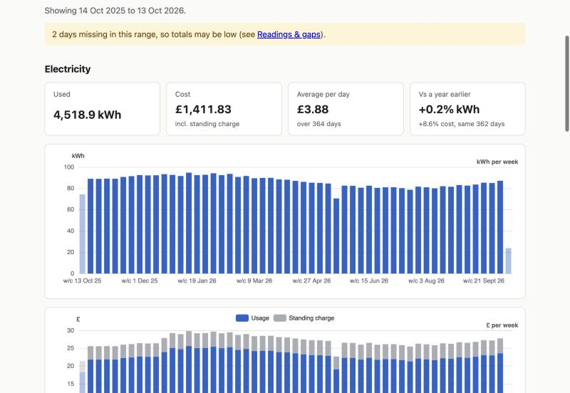
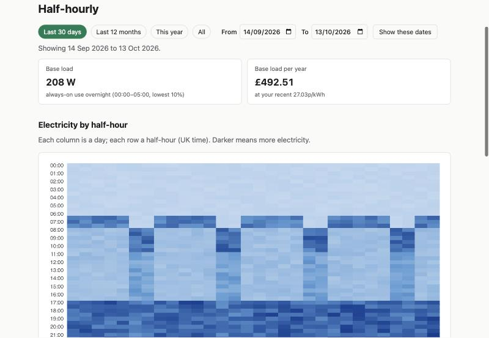
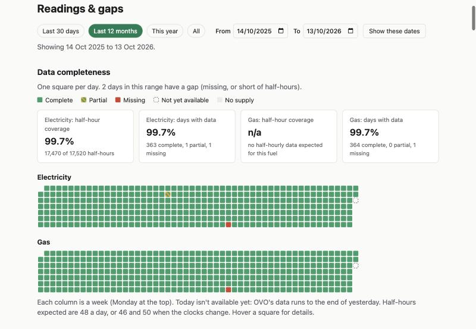
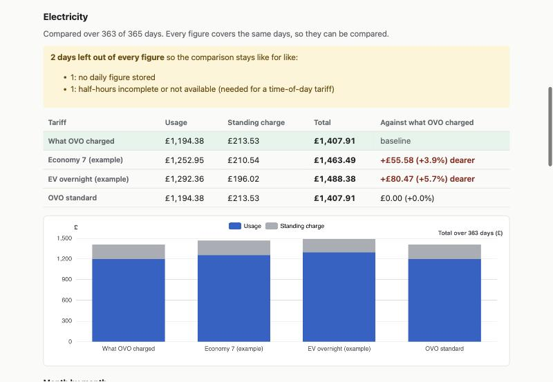

# ovo-insights

> **Unofficial — not affiliated with or endorsed by OVO Energy. Use at your own risk.**
> This tool talks to OVO's private, undocumented web APIs using your own account credentials. Those APIs can change or block access without notice.

A local-only web app for macOS that archives your OVO Energy smart-meter data on your own machine and helps you make sense of it: usage and cost over time, half-hourly patterns and base load, what your usage would have cost on a different tariff, and how complete your data is. Your data never leaves your Mac; the only outbound connections are to OVO.

| | |
|---|---|
|  |  |
| **Dashboard.** Usage and cost per day, week or month, with the change against a year earlier. | **Details.** A heatmap of every half-hour, a typical day, and your always-on base load. |
|  |  |
| **Readings & gaps.** Your meter readings, checked against the smart-meter data, and a calendar of missing days. | **Tariffs.** Enter a tariff and see what the same usage would have cost, next to what OVO charged. |

*(Screenshots are of `ovo-insights demo`, which uses made-up data.)*

## Install

You need a Mac, [uv](https://docs.astral.sh/uv/), and your OVO login.

```bash
uv tool install git+https://github.com/sjanaway/ovo-insights
```

Or, from a copy of the code:

```bash
git clone https://github.com/sjanaway/ovo-insights.git
uv tool install ./ovo-insights
```

Check it worked:

```bash
ovo-insights --version
```

If your shell says the command isn't found, run `uv tool update-shell` and open a new terminal.

To update, run `uv tool install --reinstall git+https://github.com/sjanaway/ovo-insights` (or the same command from your copy after `git pull`). To remove the program, run `uv tool uninstall ovo-insights`. That leaves your data alone; see [Delete everything](#delete-everything).

## First run

**1. Try it without an OVO account.** This opens the app with two years of made-up data in a temporary folder, deleted when you press Ctrl-C. Your real data, your login and OVO are never touched.

```bash
ovo-insights demo
```

**2. Save your login and check it works.**

```bash
ovo-insights login
ovo-insights doctor
```

`login` asks for your OVO email and password (the password isn't shown), checks them with OVO, and saves them in the macOS Keychain. `doctor` makes about ten requests to OVO and prints a pass/fail line for each part. Its output contains counts only: no account numbers, meter details or amounts.

**3. Download your data.**

```bash
ovo-insights sync --dry-run
ovo-insights sync
```

`--dry-run` shows what would be fetched without writing anything. `sync` downloads up to two years of monthly, daily and half-hourly usage, plus your meter readings, into a private database on your Mac. The first run makes one request per day of history, at most one every two seconds (slower if OVO asks), so two years takes at least 25 minutes. You can stop it at any time with Ctrl-C; the next run resumes where it left off. Later runs fetch only what's new, the last few days (OVO sometimes revises them) and anything still incomplete.

The exit code is 0 when everything synced, 3 if it stopped part-way (run it again to resume), 4 if OVO blocked the request (wait hours, not minutes), 5 if another sync is already running, and 1 for anything else.

**4. Open the app.**

```bash
ovo-insights serve
```

This starts the app on this Mac only (`127.0.0.1`, on a free port) and opens your browser with a sign-in link. The link works once; restart `serve` for a new one. Press Ctrl-C to stop. `--no-open` just prints the link; `--port N` picks the port.

While `serve` is running it also syncs once a day, between 06:00 and 08:00, and there's a **Sync now** button on the Sync page.

## What's in the app

- **Dashboard:** usage and cost per day, week or month; year-on-year comparison; custom date ranges (on every page).
- **Details:** the half-hourly data: heatmap, typical weekday and weekend, and base load in watts and £ a year for any dates and any time of day you choose (even past midnight), with a chart of it night by night.
- **Tariffs:** enter your own tariffs (flat, time-of-day, different weekend rates, price changes on a date) and compare. Days that can't be costed fairly are left out of every figure, and the page says how many and why.
- **Readings & gaps:** every meter reading; consumption worked out from the readings against the smart-meter totals (flagging differences over 5%); a calendar showing which days are complete, partial or missing.
- **Export:** CSV files for any date range, one per dataset or all in a zip. Columns and units are in [docs/csv-format.md](docs/csv-format.md).
- **Sync, Setup, Settings:** sync history and status, saving or forgetting your login, deleting your data.

## Where things live

| What | Where |
|---|---|
| Your downloaded data | `~/Library/Application Support/ovo-insights/ovo-insights.sqlite3` (folder readable by you only) |
| Logs | `~/Library/Application Support/ovo-insights/logs/` (secrets masked) |
| Your OVO email and password | The macOS Keychain, one item named `ovo-insights` (open Keychain Access and search for it) |
| Login tokens | Memory only, never saved |

Set `OVO_INSIGHTS_DATA_DIR` (to an absolute path) to keep the data somewhere else. The database is a plain SQLite file, so you can open it with any SQLite tool.

## Back up your data

```bash
ovo-insights backup
```

This makes a safe copy of your database in `~/Backups/ovo-insights/` (a private folder, made if it isn't there), named like `ovo-insights-20261014T113005Z.sqlite3`. It works while the app is running, even mid-sync, and checks the copy afterwards (it prints how much is in it). It never overwrites anything. Options: `--to FOLDER` to choose where (it must be private to you, and outside the data folder), and `--keep N` to delete all but the newest N backups afterwards (it only ever deletes its own backups, and nothing at all without `--keep`).

A backup holds your usage, readings and **tariffs** (which can't be downloaded again), but not your OVO login, which stays in the Keychain. It shows when you're home, so keep it somewhere private. A folder that syncs to the cloud uploads it.

To restore, stop `ovo-insights serve`, then:

```bash
cd ~/Library/Application\ Support/ovo-insights
mv ovo-insights.sqlite3 ovo-insights.sqlite3.old
rm -f ovo-insights.sqlite3-wal ovo-insights.sqlite3-shm
cp ~/Backups/ovo-insights/ovo-insights-20261014T113005Z.sqlite3 ovo-insights.sqlite3
chmod 600 ovo-insights.sqlite3
```

(Use your backup's file name.) The app upgrades an older backup when it starts, and refuses one from a newer version of the app.

## Delete everything

- **The downloaded data and logs:** Settings → *Delete all data* (type `DELETE`), or delete the folder `~/Library/Application Support/ovo-insights/` while the app isn't running.
- **Your saved login:** `ovo-insights logout`, or Settings → *Forget my login*.
- **The program:** `uv tool uninstall ovo-insights`.
- **Backups** made with `ovo-insights backup` are in `~/Backups/ovo-insights/` (or wherever you chose): delete them too.
- **Files you exported** are wherever your browser saved them (usually Downloads). They show how you use energy; delete them when you're done.

## Is it safe?

- **Your data stays on your machine.** No telemetry, no analytics, no CDNs, no update checks. The only outbound connections are to OVO's three hosts, and anything else is refused.
- **Your password lives in the macOS Keychain**, never in a file or a log. Login tokens are held in memory only.
- **Localhost only.** The web UI binds to `127.0.0.1`, checks the `Host` header, and needs a one-time sign-in link, a strict same-site cookie and a CSRF token. The page policy forbids inline scripts.
- **Polite to OVO.** Requests are throttled, and the app stops, rather than retries, when OVO says no.

After you've logged in and synced, `ovo-insights dev verify` checks that your data folder is private and that your password and login tokens aren't written anywhere they shouldn't be. The full threat model, with what is and isn't covered and the test that enforces each protection, is in [docs/security.md](docs/security.md); the pre-release checks are in [docs/verification.md](docs/verification.md). To report a security problem, see [SECURITY.md](SECURITY.md).

## If it breaks

OVO's APIs are private and can change. Run:

```bash
ovo-insights doctor
```

It shows which part stopped working. If it's an OVO change, [open an "OVO API change" issue](https://github.com/sjanaway/ovo-insights/issues/new/choose) and paste the `doctor` output. **Never paste your password, tokens, cookies, account numbers, MPAN/MPRN, meter serials or screenshots of your real data.** Your downloaded data keeps working while the API doesn't. Later syncs top it up when the app is fixed.

If you see a message about being blocked (exit code 4), stop and wait several hours before trying again.

## Development

Requires [uv](https://docs.astral.sh/uv/) and Python 3.13+. See [CONTRIBUTING.md](CONTRIBUTING.md) for the rules (no real data in git, tests with every change).

```bash
uv sync
uv run pre-commit install
uv run ruff check . && uv run ruff format --check . && uv run mypy && uv run pytest
```

CI runs these on macOS and Ubuntu with Python 3.13 and 3.14. The plan and decisions are in [the PRD](docs/product/ovo-insights-prd.md) and [docs/adr](docs/adr/). Releases are described in [CHANGELOG.md](CHANGELOG.md): pushing a `vX.Y.Z` tag builds the wheel and sdist and attaches them to a GitHub release (nothing is published to PyPI).

## Licence

MIT. See [LICENSE](LICENSE).
